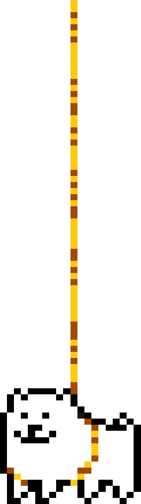

<h1>👨‍💻 Hi! I'm Minho.</h1>

I am researcher and developer working on (optimal+robust) control, optimization, and game theory, with applications to distributed energy systems and (bio)chemical/industrial processes. I am the main maintainer of the [KoiraLabs](https://github.com/KoiraLabs/), a small project developing lightweight software for automation and control applications. I also like noisy music, the concept of dogs, and old video-games.  

For more information, publications and general stuff, check out my [website](https://tiominho.github.io/)!

